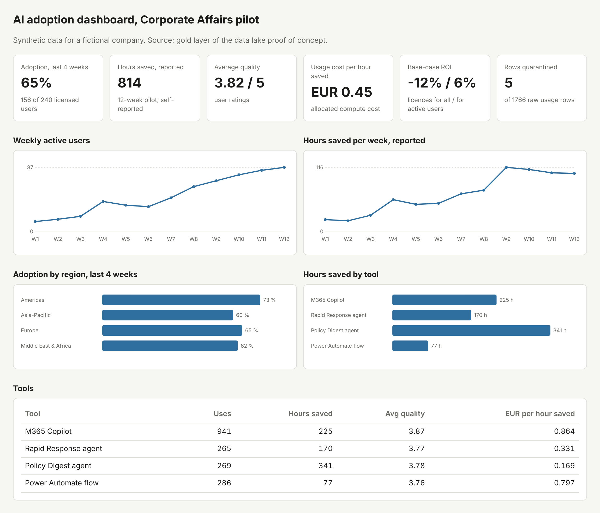

# AI adoption blueprint for a Corporate Affairs function

A small, end-to-end example of how to plan, pilot and measure AI in a Corporate Affairs team:
map the value streams, find the pain points and the value at stake, build a data lake proof of
concept with quality checks, track adoption and value with KPIs, and write the business case and
the scale-up roadmap.

The company ("Example Group") is fictional and all data is synthetic. The Microsoft parts
(Copilot Studio, Copilot Cowork, Power Automate, Power BI) are written as designs, skills and
measures, not deployed in a tenant. The Python pipeline runs end to end and is tested.



## What is inside

| Part | What it does | Where |
|---|---|---|
| Value stream mapping | Current and future state for Rapid Response and Policy Intelligence Reporting: touch time, waiting time, lead time, flow efficiency, pain points, value at stake, remaining bottleneck, Mermaid maps | `blueprint/value_streams.json`, `aab/value_stream.py` |
| Data lake proof of concept | Bronze (raw copy with checksum), silver (validated, personal data masked, bad rows quarantined with a reason), gold (KPI tables and a star schema), data catalog with owners | `aab/lake.py` |
| Adoption and value KPIs | Adoption by week and region, hours saved, quality ratings, cost per hour saved, per tool | `aab/lake.py`, `aab/dashboard.py` |
| Business case | Three scenarios, two licence models, every assumption written out | `aab/business_case.py` |
| Policy Digest agent logic | Weekly digest by region with sources and a review notice; high severity items go to a Rapid Response queue | `aab/policy_digest.py` |
| AI portfolio tracking | Use cases with stage, owner, risk level and review status; flags pilots without completed reviews | `governance/ai_portfolio.csv`, `aab/portfolio.py` |
| Responsible AI | Rules for human oversight, transparency, sources, privacy, security and the EU AI Act | `governance/responsible-ai.md` |
| Copilot Studio agent | Design of the Rapid Response agent: knowledge, topics, answer rules, test set | `copilot-studio/rapid-response-agent.md` |
| Copilot Cowork skills | Two custom skills (`SKILL.md`) for the weekly policy digest and the Rapid Response brief, with approval points and pre-pilot tests | `copilot-cowork/` |
| Power Automate flow | Design of the parallel approvals flow in Teams | `power-automate/approvals-flow.md` |
| Power BI | Star schema and DAX measures for the adoption dashboard | `powerbi/` |
| Blueprint and roadmap | Target processes, data flows, agents, roles, KPIs, business case, 12-month scale-up plan | `blueprint/BLUEPRINT.md`, `blueprint/roadmap.md` |

## Run it

Python 3.10 or newer, standard library only.

```bash
python3 -m unittest discover -s tests -v   # 18 tests
python3 -m aab.run                         # writes everything to out/
./scripts/run_demo.sh                      # tests + run + copy main outputs to evidence/
```

## Results of the pilot run

| KPI | Value |
|---|---:|
| Adoption, last 4 weeks | 65% (156 of 240 users) |
| Hours saved, self-reported, 12 weeks | 814 |
| Average quality rating | 3.82 / 5 |
| Usage cost per hour saved | EUR 0.45 |
| Usage rows quarantined | 5 of 1,766 |
| Base-case ROI, licences for all / for active users | -12% / 6% |

| Value stream | Hours of work saved per year | Lead time | Remaining bottleneck |
|---|---:|---:|---|
| Rapid Response | 364 | 63% shorter | Legal and leadership approval |
| Policy Intelligence Reporting | 3,182 | 70% shorter | Review and sign off |

What the numbers say:

- Licences for people who rarely use the tools cost more than the time saved. Licensing by active
  use turns the base case positive.
- The two agents save the most hours per euro. Scale them before widening generic licences.
- After AI, the delay that is left is people waiting for approval. That is the next thing to fix.
- Self-reported savings are only partly counted (25 to 55%) and should be checked with timed tasks.

## Evidence

Outputs of the last run are in [`evidence/`](evidence/): KPI tables, quality report, data
catalog, business case, value streams, portfolio summary, weekly policy digest, dashboard and
test log.

## Limits

- Synthetic data, fictional company, assumed hourly cost and licence price.
- Copilot Studio, Copilot Cowork, Power Automate and Power BI parts are designs, skills and measures, not deployed.
- The Policy Digest logic groups and filters news; it does not call a language model.

## License

MIT
