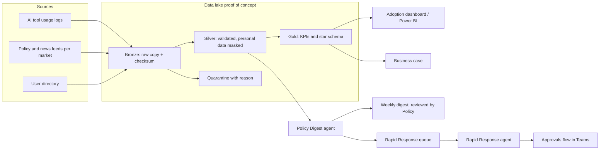

# Connected Intelligence Blueprint, Corporate Affairs

How a Corporate Affairs function can move from scattered AI experiments to a small set of measured
use cases on shared data. Written for a fictional company ("Example Group"). Every number below
comes from the synthetic pilot in this repository and from assumptions that are written out.

## 1. Target processes

Two value streams were mapped end to end, from trigger to outcome. Details, owners and pain points
per step are in [`value-streams.md`](../evidence/value-streams.md).

| Value stream | Trigger | Runs per year | Lead time now | Lead time target | Main pain point |
|---|---|---:|---:|---:|---|
| Rapid Response | Media query or market event | 72 | 26.5 h | 9.8 h | Searching for past positions, approvals one after another |
| Policy Intelligence Reporting | Weekly cycle and market alerts | 208 | 47.0 h | 14.2 h | Manual collection and tagging of news from many markets |

Value at stake, at EUR 65 per hour: about 360 hours a year for Rapid Response and about
3,180 hours a year for Policy Intelligence Reporting. The bigger prize is the weekly reporting, not
the crisis work, because it runs almost three times as often and has more manual steps.

What the maps also show: after the AI changes, the remaining delay is waiting for people, not
working time. Rapid Response still waits on legal and leadership approval, and the weekly report
waits on review and sign off. The next iteration should target those two steps, not add more AI.

## 2. Data flows

Rules that keep the data usable:

- Bronze is never edited. Each file has a checksum in `_manifest.json`, so any figure can be traced back.
- Bad rows are quarantined with a reason, not dropped. In the pilot run 5 of 1,766 usage rows and
  5 of 162 news rows were quarantined.
- E-mail addresses in free-text comments are masked before anything reaches the silver layer.
- Every dataset has a named owner in `catalog.json`.

## 3. Agents, automations and tools

| Tool | Role in the process | Status in this repo |
|---|---|---|
| Microsoft 365 Copilot | Summaries, e-mail drafts, meeting recaps for all users | Usage simulated in the pilot data |
| Rapid Response agent (Copilot Studio) | Finds approved past positions, drafts a holding statement with sources | Design in `copilot-studio/` |
| Policy Digest agent | Groups validated news by region, flags high severity items | Logic in `aab/policy_digest.py` |
| Copilot Cowork skills | Multistep tasks across Word, Outlook, Teams and SharePoint: weekly digest on a schedule, Rapid Response brief on an incoming e-mail, approval before sending or posting | Two custom skills in `copilot-cowork/` |
| Approvals flow (Power Automate) | Sends the draft to legal and leadership in parallel, with reminders | Design in `power-automate/` |
| Power BI | Adoption and value dashboard on the gold star schema | Measures in `powerbi/measures.dax` |

Principle: AI prepares, a person approves anything that leaves the team.

## 4. Roles

| Role | Who | What they do |
|---|---|---|
| Process lead | One per value stream (Head of Communications, Head of Policy) | Owns the future state, signs off changes, decides go or no go |
| Data curator | One per dataset | Fixes quarantined rows, keeps sources and tags up to date |
| AI champion | One or two per region and function | First-line help, collects feedback, runs short demos |
| CA AI team | Small central team | Builds agents and flows, runs the lake, reports KPIs |
| Legal, privacy and security | Existing functions | Review every use case before pilot and before scale |

## 5. KPIs

| Area | KPI | Pilot value |
|---|---|---:|
| Adoption | Active users in the last 4 weeks out of licensed users | 65% (156 of 240) |
| Productivity | Self-reported hours saved over 12 weeks | 814 h |
| Quality | Average user rating of AI output, 1 to 5 | 3.82 |
| Cost efficiency | Usage cost per hour saved | EUR 0.45 |
| Data quality | Rows quarantined | 5 usage rows, 5 news rows |
| Governance | Pilots without completed reviews | 0 |

Adoption is uneven by design of the rollout waves: Europe started in week 1, Middle East & Africa
in week 9. Regional numbers are on the dashboard.

## 6. Business case

Full table in [`business-case.md`](../evidence/business-case.md). Only part of the self-reported
time is counted (25%, 40% or 55%), because people tend to overestimate time saved.

| Licence model | Annual cost | ROI low | ROI base | ROI high |
|---|---:|---:|---:|---:|
| Licence for all 240 users | EUR 168,269 | -45% | -12% | 21% |
| Licence for the 156 active users | EUR 140,045 | -34% | 6% | 46% |

Reading: licences for people who rarely use the tools cost more than the time saved. The two
agents give the most hours per euro (EUR 0.17 and EUR 0.33 of usage cost per hour saved, against
EUR 0.86 for generic Copilot use). So the order is: scale the agents first, license by active use,
then widen.

## 7. Scale-up roadmap

Twelve months in four steps. Details and exit criteria in [`roadmap.md`](roadmap.md).

1. **Months 1 to 3, measure properly.** Timed task samples next to self-reports, real licence price, real data sources in the lake.
2. **Months 4 to 6, scale the agents.** Rapid Response and Policy Digest to all regions, parallel approvals live.
3. **Months 7 to 9, fix the waiting.** Approval service levels, sign-off rules for the weekly report, next two use cases from the portfolio.
4. **Months 10 to 12, run it as a product.** Champions network in every region, quarterly portfolio review, licence model based on use.

Scale rule for every use case: the low scenario must at least break even, quality must stay at
4 out of 5 or above, and the responsible AI and privacy reviews must be done.
