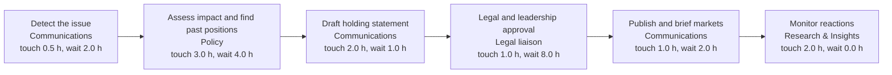
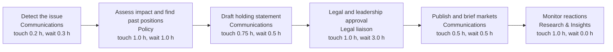
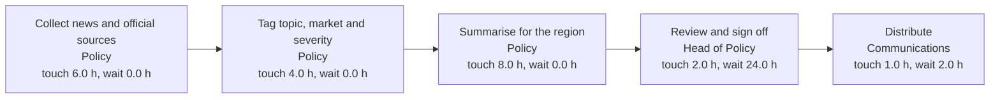
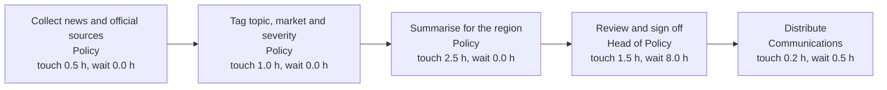

# Value streams: current and future state

_Illustrative durations for a fictional Corporate Affairs team, to be replaced by interview and timing data during pilots. Loaded cost assumption: EUR 65 per hour._

## Rapid Response

Trigger: A sensitive news item or stakeholder question needs a public position within hours. Runs per year: 72.

| | Current | Future |
|---|---:|---:|
| Touch time | 9.5 h | 4.45 h |
| Waiting time | 17.0 h | 5.3 h |
| Lead time | 26.5 h | 9.75 h |
| Flow efficiency | 36% | 46% |

Value at stake: 364 hours of work per year, about EUR 23,634; lead time 63% shorter.

Remaining bottleneck in the future state: **Legal and leadership approval** (3.0 h of waiting). Flow efficiency improves because waiting time falls as well as working time.

| Step | Owner | Pain point | Future change |
|---|---|---|---|
| Detect the issue | Communications | Alerts arrive by email and are missed outside office hours | Monitoring agent flags and summarises high-severity items |
| Assess impact and find past positions | Policy | Past positions spread across SharePoint sites, emails and slide decks | Rapid Response agent (Copilot Studio) searches approved positions with sources |
| Draft holding statement | Communications | Each draft starts from a blank page | Agent drafts from approved language, writer edits |
| Legal and leadership approval | Legal liaison | Sequential approvals by email, no status visibility | Power Automate parallel approvals with reminders and status |
| Publish and brief markets | Communications | Briefing packs rebuilt and translated by hand per market | Briefing pack generated and translated, checked by market leads |
| Monitor reactions | Research & Insights | Manual media counts in spreadsheets | Reaction dashboard fed from the data lake |

Current state:

Future state:

## Policy Intelligence Reporting

Trigger: Weekly report on regulatory developments for each region. Runs per year: 208.

| | Current | Future |
|---|---:|---:|
| Touch time | 21.0 h | 5.7 h |
| Waiting time | 26.0 h | 8.5 h |
| Lead time | 47.0 h | 14.2 h |
| Flow efficiency | 45% | 40% |

Value at stake: 3182 hours of work per year, about EUR 206,856; lead time 70% shorter.

Remaining bottleneck in the future state: **Review and sign off** (8.0 h of waiting). Flow efficiency falls because AI removes working time faster than waiting time, so waiting becomes the main target of the next iteration.

| Step | Owner | Pain point | Future change |
|---|---|---|---|
| Collect news and official sources | Policy | Copy and paste from many websites and newsletters | Feeds land in the data lake, deduplicated and checked |
| Tag topic, market and severity | Policy | Inconsistent tags between analysts | Policy Digest agent proposes tags, analyst confirms |
| Summarise for the region | Policy | Long summaries written from scratch every week | Draft digest with sources, analyst edits |
| Review and sign off | Head of Policy | Report waits in an inbox for review | Review task with deadline and reminder |
| Distribute | Communications | Distribution lists maintained by hand | Power Automate posts to Teams channels and email lists |

Current state:

Future state:

